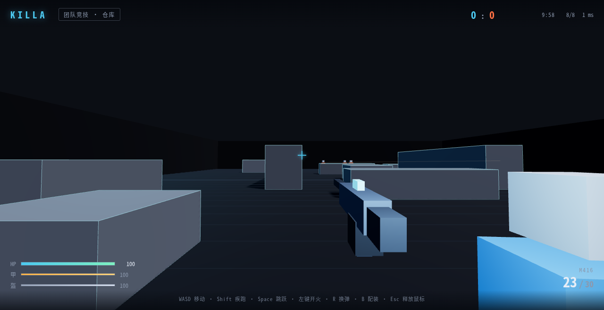

# KILLA

一个 4v4 的网页多人射击游戏。规则参考 PUBG Mobile 的团队竞技（Team Deathmatch）：
单张仓库图、40 杀 / 10 分钟、无限复活、出生点配装、机器人补位。

- 客户端：TypeScript + Three.js（几何体 / 线框风格，无写实素材）
- 服务端：Go，权威模拟
- 传输：WebSocket + JSON（MVP 阶段，后续升级低延迟方案）
- 身份：游客 ID，暂不做账号系统

> 仅借鉴玩法规则，不使用任何 PUBG 的素材、名称或商标。



## 快速开始

需要 Go 1.24+、Node 22+、npm。

```bash
# 1. 安装客户端依赖
cd client && npm install && cd ..

# 2. 开发模式（两个终端）
# 终端 A：游戏服务器 :8080
make dev-server
# 终端 B：Vite 开发服务器 :5173（/ws 已代理到 :8080）
make dev-client
```

打开 http://localhost:5173 ，点击「进入战场」锁定鼠标即可。

生产构建（单进程同时提供页面和 WebSocket）：

```bash
make build
./server/killa -addr :8080 -static ./client/dist
# 打开 http://localhost:8080
```

开发时可以用 `-match-seconds 20 -score-limit 5` 快速跑完一局；
`-bots=false` 可关闭机器人（单人时不会自动开局）。

## 操作

| 按键 | 动作 |
| --- | --- |
| W A S D | 移动 |
| 鼠标 | 视角 |
| Shift | 疾跑 |
| Space | 跳跃 |
| 左键 | 开火 |
| 右键 | 开镜（ADS） |
| R | 换弹 |
| B | 配装（下次复活生效） |
| Esc | 释放鼠标 |

本地双人验收：一个窗口正常进入对局，另一个窗口打开 `http://localhost:5173/?spectate=1`
以观察模式进入（不锁定鼠标、不发送输入），即可在旁边看到对方移动。

## 部署

生产部署使用 Docker + Caddy（自动 HTTPS/wss）：

```bash
cp .env.example .env   # KILLA_DOMAIN 已填 manyblocks.online
docker compose up -d --build
```

完整步骤、备案/防火墙/压测/排障见 [docs/deploy.md](docs/deploy.md)。

## 目录

```
client/           TypeScript + Vite + Three.js 客户端
  src/            入口、网络、场景、预测移动
server/           Go 权威服务器
  cmd/killa/      入口
  internal/game/  房间、玩家、移动与碰撞
  internal/transport/ WebSocket 接入
  internal/protocol/  消息定义
docs/             规则、架构、协议、路线图
```

## 当前状态

- [x] 项目骨架、协议、本地一键运行
- [x] 4v4 进房、服务端权威移动、客户端预测与插值
- [x] 射击 / 命中 / 血量 / 死亡复活（基础版，含击杀播报与死亡倒计时）
- [x] 40 杀 / 10 分钟比赛流程、比分、结算与自动重开（Tab 查看计分板）
- [x] 机器人补位、A* 导航、索敌与开火（基础版）
- [x] 武器数据表、配装、弹匣/换弹、护甲减伤与受击反馈（基础版）
- [x] 可跳上箱顶、低平台掩体、程序化音效、开局倒计时（基础版）
- [x] 多房间匹配（每房 4v4，`-rooms` 上限，优先合房）
- [x] 合规页面模板：隐私说明、用户协议、适龄提示；连接限流与连接数上限
- [x] 灵敏度/音量/配装本地持久化；断线自动重连（最多 5 次）；`/status` 运维接口
- [x] ADS 红点镜、命中方块粒子、参考 myold/tdm 第一层重制的更大仓库图
- [x] PUBG 数值同步：M416/UZI 伤害、2 级甲 40%、脱战回血；机器人进一步降智
- [x] 部署产物：Docker + Caddy + 压测工具 + 部署文档
- [ ] 部署到实际 VPS（需要域名、备案与服务器访问）

详见 [docs/roadmap.md](docs/roadmap.md)。
