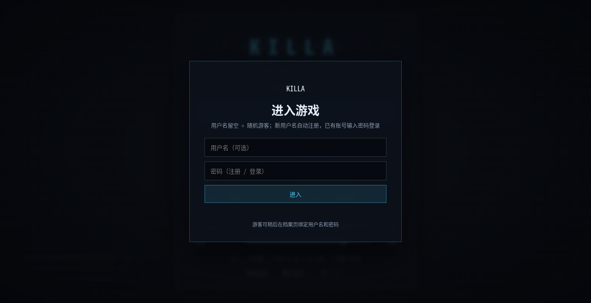
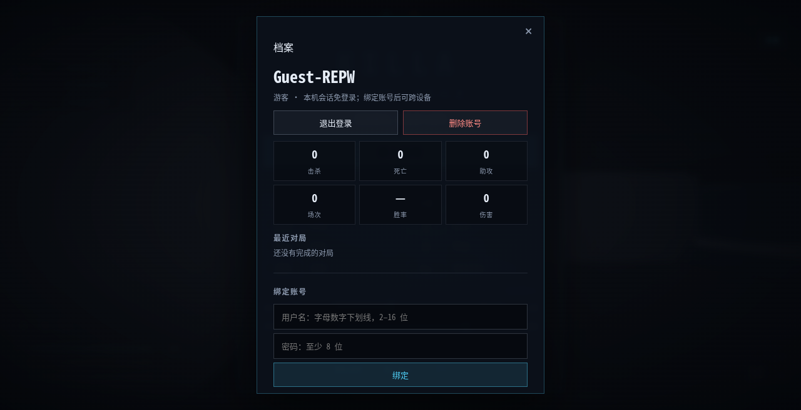

# 账号与档案

KILLA 使用匿名档案 + 可选用户名密码。没有邮箱、手机号、第三方登录，也没有找回密码流程。

## 行为

- 登录框用户名留空：创建随机游客档案（`Guest-XXXX`），只靠本机会话自动登录
- 用户名 + 密码：
  - 用户名不存在：注册并登录
  - 用户名存在：校验密码
- 游客可在档案页绑定用户名和密码，之后可跨设备登录
- 登录后先进入大厅，选主武器/设置，点「开始匹配」后连接房间并直接进入战场
- 对局结束后停留在结算页，点「返回大厅」再开下一局
- 密码要求只有长度 8–128 位，不做大小写/符号组合要求
- 用户名：2–16 位 `A-Z a-z 0-9 _`，大小写不敏感唯一
- 忘记密码 = 账号无法找回

## 会话

- 登录成功写入 `killa_session` cookie：`HttpOnly`、`SameSite=Lax`、HTTPS 下 `Secure`，30 天
- 服务端只保存 token 的 SHA-256；明文只在 cookie 中
- 同一档案允许多个设备会话；修改密码会踢掉其他会话
- WebSocket 握手从 cookie 解析档案，客户端不能伪造昵称/配装

## HTTP API

| 方法 | 路径 | 说明 |
| --- | --- | --- |
| GET | `/api/session` | 当前会话档案 |
| POST | `/api/auth` | `{username, password}`；用户名为空即游客 |
| GET | `/api/me` | 档案 + 最近 20 场 |
| POST | `/api/profile` | 保存 `{settings, loadout}` |
| POST | `/api/account/upgrade` | 游客绑定 `{username, password}` |
| POST | `/api/account/password` | `{currentPassword, newPassword}` |
| POST | `/api/auth/logout` | 注销当前会话 |
| DELETE | `/api/account` | 删除档案；正式账号需 `{password}` |

所有写接口校验 `Origin`；登录/注册按 IP 与用户名限流。

## 数据表（SQLite）

- `profiles`：用户名、Argon2id 密码哈希、昵称、设置、配装、累计 K/D/A/伤害/爆头/场次/胜场
- `sessions`：token 哈希、档案、过期时间
- `matches`：房间、开始/结束、比分、胜者
- `match_players`：每场每人的队伍、K/D/A、伤害、爆头

对局结束时由房间回调投递到写入队列，异步落库，不阻塞 20Hz 循环。
只有带 `ProfileID` 的真人写入；机器人忽略。

## 安全与限制

- 密码：Argon2id（32 MiB、t=3、p=2），每用户随机 salt
- 会话 token：32 字节随机，数据库只存哈希
- 登录失败限流：每 IP / 每用户名 10 次/分钟；游客建档每 IP 60 次/分钟
- 删除账号会级联删除会话与 `match_players`，并清理没有参与者的空 `matches`
- 没有 PII，没有找回密码；换设备必须知道用户名密码

## 运维

- 开发默认数据库 `./killa.db`；Docker 使用 `/data/killa.db`
- SQLite 使用 WAL；单进程、低并发下不需要额外数据库
- 备份：停写或使用 SQLite backup 命令复制 `killa.db`（以及 `-wal`/`-shm`）
- 将来多实例部署时，把 `internal/store` 换成 Postgres 实现即可
